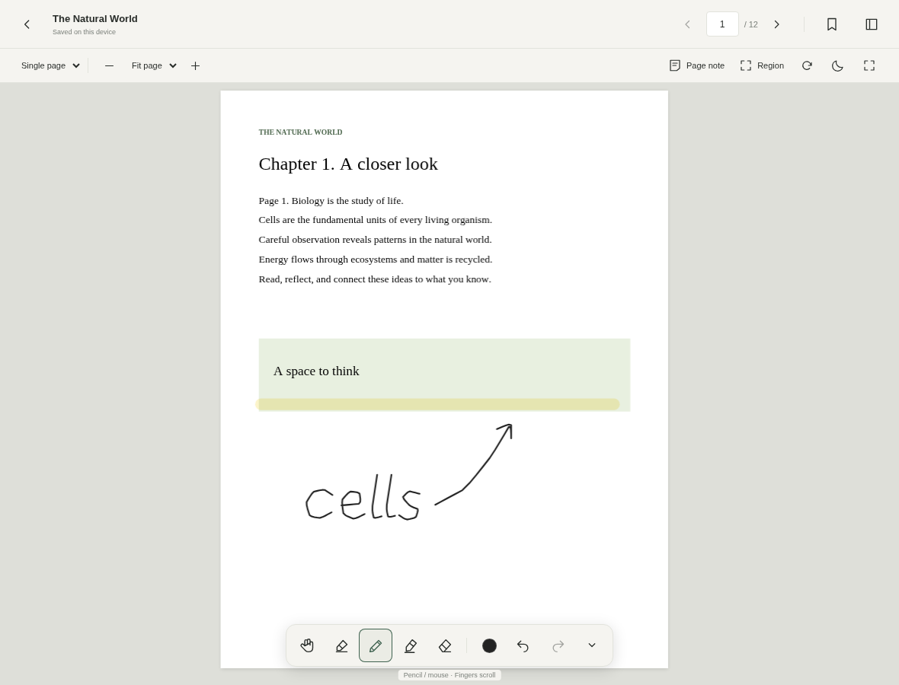
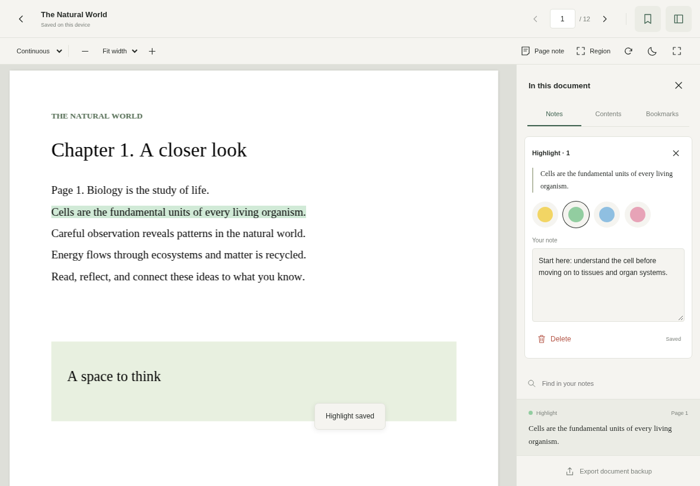

# LWPDFReader

A private, offline-first PDF reader for iPad and modern desktop browsers. Import a PDF from Files, read it in a virtualized viewer, select actual PDF text, highlight it, and keep notes and bookmarks alongside the original file.

## Run from a fresh checkout

Use Node 24 (or Node >=22.13) and npm. Rust is **not required** for the frontend build: the tested WASM binary and generated bindings are committed.

```sh
npm ci
npm run dev
```

Open the printed local URL. `postinstall` copies PDF.js fonts, character maps and decoding WASM into `public/pdf`; nothing is fetched from a CDN. To check the installable, offline production application:

```sh
npm run build
npm run preview
```

Offline caching runs in production builds, not the development server. Use HTTPS when hosted; localhost is allowed for development. Wait for **Ready to read offline** before disconnecting for the first time.

## Use

- **Import PDF** opens the device file picker. A content SHA-256 ID prevents duplicate library entries and reconnects backups to reimported originals, even after renaming a file.
- Previous/next, page input, arrow keys and Page Up/Down navigate. Choose continuous or single-page mode, fit width/page, or a custom zoom. Browser-native pinch zoom is available on iPad; toolbar zoom changes the PDF layout. Rotate on wider screens. Focus mode hides the toolbars.
- Select text on **one page**, then choose a highlight color in the bottom toolbar. Multi-line selection is supported. For scanned pages, choose **Region**, drag an area, then return to normal scrolling. No OCR is performed.
- Tap an existing highlight, or find it in the sidebar, to recolor, delete or add a note. Notes save 450 ms after typing, on blur and on backgrounding. Failed note saves keep the editor open when leaving, so the draft can be retried. Saved annotation actions commit immediately to IndexedDB. Use the bookmark button to keep a page.
- Library **Export backup** saves all annotation metadata and reading positions; the sidebar exports the current document. **Restore backup** validates the complete file before one atomic merge. The most recently updated copy of an annotation wins.
- **Backups do not include PDF files.** Keep the original PDFs separately. Restored documents without files appear in the library; import the same original PDF to reconnect them.
- Add to Home Screen in Safari’s Share menu to install. After the shell has cached and PDFs have imported, reading and annotations work offline.

## Pen, marker and eraser

The docked annotation toolbar now includes Hand, Text highlight, Pen, Freehand highlighter, Eraser, width/color options and Undo/Redo. Pencil-style pointer input supports pressure and coalesced events when available. Fingers pan by default; finger drawing is optional. Use Hand for native pinch zoom. Marker opacity is applied once per original stroke; precision erasing splits persistent vectors, while whole-stroke erasing removes the original stroke's remaining fragments. Collapse or Focus switches to reading mode.

Saved ink, including undo/redo results, survives reloads and is included in v2 JSON backups. Existing v1 backups still import and existing study data migrates in place. Undo history lasts for the open session. Failed writes retain unsaved vectors with a Retry ink action. Browser palm rejection and Apple Pencil double-tap/native API parity are not guaranteed. See [tool behavior, architecture and real-iPad checklist](docs/PENCIL.md).

## Data and privacy

All PDFs and study data stay in this origin’s IndexedDB. There are no accounts, backend, analytics, remote fonts or document uploads. File hashing and PDF parsing run in workers. The original PDF is immutable. The application only requests its same-origin application resources.

Persistent storage is requested where supported, but **iPadOS or the browser can still clear local data**. Use regular JSON backups and keep original PDFs. Private browsing and changing domains can prevent or isolate storage. A failed write is reported; do not dismiss a save error without correcting the cause or exporting what is available. Use one active reader tab per library; simultaneous editing across tabs is not coordinated in this release.

Updates wait for an explicit action from the library. Service-worker cache cleanup never touches IndexedDB.

## Verify

```sh
npm test                       # TypeScript + IndexedDB + real WASM validation
npm run check                  # strict TypeScript and Svelte diagnostics
npm run build                  # production + offline shell
npm run test:browser            # Chromium E2E against production preview
cargo test --manifest-path core/Cargo.toml --locked
```

Playwright defaults to `/usr/bin/chromium` in Codex Cloud. For Playwright’s bundled browser:

```sh
npx playwright install chromium
PLAYWRIGHT_CHROMIUM_EXECUTABLE='' npm run test:browser
```

Original synthetic PDFs are committed in `tests/fixtures`. Regenerate with `npm run fixtures`. No proprietary textbook is included. For the optional 163 MiB image-heavy stress fixture, run `npm run fixtures:heavy`; it is generated locally and excluded from Git. See [testing](docs/TESTING.md), [architecture](docs/ARCHITECTURE.md) and [performance](docs/PERFORMANCE.md).

## Rust / WASM development

Install rustup; `rust-toolchain.toml` pins Rust and the WASM target. Then:

```sh
cargo install wasm-pack --locked --version 0.13.1
npm run wasm:build
cargo test --manifest-path core/Cargo.toml --locked
npm test
npm run build
```

Commit changes in `src/wasm` with their Rust source. `wasm-bindgen` is pinned in `core/Cargo.toml`; Cargo dependencies are locked. `wasm-opt` is disabled to avoid an implicit platform-specific binary download; LLVM size optimization and LTO remain enabled. The build normalizes source paths and removes optional producer metadata (which differs between downloaded and cargo-built bindgen tools). CI rebuilds the artifacts and checks for drift. Build from the repository root.

## Deploy to Vercel

Import this GitHub repository, choose Vite, set Node 24, install with `npm ci`, build with `npm run build`, and publish `dist`. `vercel.json` includes the static output and cache headers. No secrets, server functions, database or Rust toolchain are required. Deploy at the domain root; path-prefix hosting is not configured. Keep the same production origin to retain access to existing local libraries. Preview deployment origins have separate storage.

## First-release limits

Real iPad hardware, Safari touch selection handles, Pencil gestures, app termination and iPadOS storage eviction require the [manual acceptance procedure](docs/TESTING.md). Linux Chromium results are not iPad performance claims. Browser-native pinch magnifies the whole view; toolbar zoom refits the document. No OCR, full-document search, password-protected PDFs, editable PDF forms, or PDF export with embedded annotations. Existing PDF annotations render as part of PDF.js output but are not editable here. Text-annotation backup merging is additive and can restore deleted text records. Ink backups include deletion records to keep erased strokes erased. Text selection is restricted to one page with explicit feedback.

Large real textbooks can be much more expensive than the synthetic benchmark. Canvas allocation is bounded; PDF.js still retains document parsing data and visited range bytes. Extreme diagrams, unusual embedded fonts and damaged files can remain costly. See performance notes before making hardware claims.

## License

MIT for application and Rust source. PDF.js is Apache-2.0; its extracted text-layer stylesheet and runtime resources retain upstream notices. See [third-party notices](THIRD_PARTY_NOTICES.md).

## Preview




