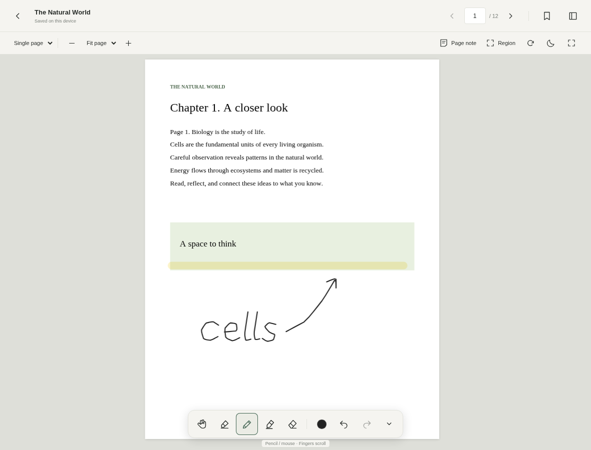

# Pencil, pen, marker and eraser tools

Persistent vector ink is shared by PDF pages and whiteboards. Automated input coverage uses Linux Chromium with mouse and emulated pen/touch, plus selected Linux WebKit workflows.

## Use

The docked toolbar has Hand, Text highlight, Pen, Freehand highlighter, Eraser, Tool options, Undo, Redo and Collapse. Its tool buttons have 44 px targets on iPad layouts. Hand allows one-finger navigation and mouse drag panning. Two-finger document-local navigation works with every tool. Text restores native PDF text selection and the existing selection-color toolbar. Pen/marker/eraser tools disable text selection on the page. Collapse selects Hand so reading does not accidentally draw. Focus reading hides the dock and also selects Hand.

Pen uses black, blue, red, green or a custom hex color. Marker has yellow, green, pink, blue, orange and custom colors, with opacity 0.28. Each tool remembers its own color and width. Options include Off, Low, Medium and High stabilization, optional finger drawing, eraser size/mode and Pen only / Marker only / Both targets. Settings are saved in IndexedDB. Text highlights, region highlights, notes and bookmarks remain independent; the ink eraser cannot remove them.

Precision erasing splits a vector centerline where the eraser's round swept path intersects the brush footprint. Cut endpoints interpolate pressure. The cut is conservatively expanded by half the stroke width so round caps do not protrude back into the erased area. It is a vector segment eraser, not a per-pixel mask capable of shaving one side off a very broad marker. Whole-stroke mode removes every surviving fragment of the touched original stroke.

Undo/redo changes actual IndexedDB state. Keyboard shortcuts are Cmd/Ctrl+Z and Cmd/Ctrl+Shift+Z outside editable text fields. History is scoped to the open document session and limited to 80 actions / 200,000 retained points. Saved results persist; undo history itself resets on reopening. Very long continuous pen/marker input is split into bounded vector chunks sharing one original stroke identity, rendering opacity and undo action.

## Input behavior and browser limits

- Pointer Events handle pen, mouse and optional touch drawing, with pointer capture, cancellation, lost capture and page/background interruption handling. Supported coalesced events are consumed in batches. The final sample is retained. Pen cancellation commits observed partial ink; a canceled finger drawing is discarded to avoid navigation marks.
- Varied/non-default pressure from a `pen` pointer drives width. Mouse/touch and default constant pen pressure use constant width. Pressure is saved per point where available. No pressure is invented for devices that do not report it. Optional smoothing operates on captured coordinates, so erasing and persisted rendering use the same centerline.
- With finger drawing off, one finger pans. With it on, a solo touch in a writing tool starts provisional ink. A second contact cancels the provisional ink or erasure, even if the first has moved. A tap can still make a dot. A captured Pencil takes precedence over stray touch input. A 350 ms guard filters large touches and blocks finger ink immediately after Pencil lift.
- The document and whiteboard surfaces use local `touch-action:none`. Two-finger movement pans and pinches around the midpoint. Browser accessibility zoom remains available outside those surfaces. Text mode still makes the PDF.js text spans selectable.
- Safari support for `getCoalescedEvents` varies; feature detection falls back to ordinary pointer events. Apple Pencil double-tap, squeeze, hover predictions, native palm-rejection APIs and native latency parity are not promised or simulated. There is no fake double-tap switch control.
- Points at the page boundary are clamped and all SVG layers clip to that page. Pointer capture allows writing near an edge, but cannot suppress all iPadOS system gestures.

References verified during implementation: [Pointer Events](https://developer.mozilla.org/en-US/docs/Web/API/Pointer_events), [touch-action](https://developer.mozilla.org/en-US/docs/Web/CSS/Reference/Properties/touch-action), [coalesced events](https://developer.mozilla.org/en-US/docs/Web/API/PointerEvent/getCoalescedEvents).

## Rendering and geometry

Each virtual page owns separate marker and pen/interaction SVG layers; no annotation canvas is allocated. The existing PDF canvas and PDF.js text layer are independent. Existing PDF text highlights stay on their own HTML layer. Marker SVG uses multiply compositing over the PDF, with group opacity applied once per original stroke, including precision-cut fragments. Self-overlapping segments therefore do not repeatedly blend within one marker stroke. Opaque pen sits above marker.

Stroke points use normalized, unrotated crop-box coordinates with bottom-left origin. Width is normalized to the shorter crop-box side. The PDF.js viewport matrix positions SVG paths, accounting for crop origin, intrinsic rotation, view rotation, zoom and PDF UserUnit. Geometry paths stay in PDF space; zoom changes the transform rather than rasterizing handwriting. Constant-width strokes use round SVG caps/joins; pressure strokes use a filled variable-width outline with round end caps.

Pointer samples and the live draft are outside framework reactive state. An event-scheduled animation frame updates the live tail of the SVG path. Completed 192-sample portions are sealed until the stroke finishes; pen input performs no per-point WASM calls or PDF rerender. Completed changes update only the affected page subscription. A page cache evicts inactive pages beyond 12; only the existing virtual window (at most nine pages) mounts interactive layers. History and pending changes are separate from that cache.

Rust validates/canonically serializes stroke batches. A per-gesture Rust `InkEraser` holds a page snapshot and a 32×32 spatial index. New eraser pointer batches query candidate bounds and use analytic circle/strip capsule intersections, including crossings between widely separated samples. Browser DOM, input, viewport conversion and SVG rendering stay in TypeScript. Rust never parses the PDF.

## Persistence, migration and backups

IndexedDB v2 added `ink` (indexed by document and document/page) and `inkDeleted`. IndexedDB v3 leaves those stores in place and adds [whiteboards and links](STUDY-WORKSPACE.md). Stroke records have their own version 1 schema. Each completed stroke or eraser action starts an immediate transactional write; dependent actions serialize. Undo and redo apply inverse transactions and check for conflicting stored vectors.

Live changes appear optimistically with an explicit pending state. Failed writes retain the unsaved vectors in memory, expose **Retry ink**, disable further new gestures and block leaving/exporting until recovery. An already active gesture is finalized into that pending queue. Page changes do not discard pending vectors. Browser force termination or a forced reload during an uncommitted/failed write cannot be guaranteed safe; wait for saving to finish and never ignore an error. Original PDFs and external backups remain necessary against iPadOS storage eviction.

Backup v2 includes legacy annotations/progress, vector strokes and timestamped ink deletion records. Backup v3 extends it when whiteboard data is present. Existing v1 and v2 backups still import. Older ink backups cannot resurrect a newer erased stroke; newer undo restoration can supersede its deletion. Text-annotation backups retain the original additive merge behavior. Backups include metadata and vectors, not original PDF files. Close older reader tabs before updating to the new database schema.

Safety limits include 8,192 points per stored vector chunk, 100,000 stroke records / 2,000,000 points per validation/export batch, and the existing 50 MiB backup file import limit. Multiple simultaneous editing tabs remain unsupported; conflicts fail visibly rather than silently replacing an edited stroke.

## Stabilization

The default uses a time-aware exponential filter whose gain increases with motion speed. Each mode imposes a maximum positional lag in CSS pixels, and the final position comes from the actual terminal event. A separate short pressure filter reduces width steps. Eraser samples bypass the stabilizer. A small distance threshold removes redundant coincident samples.

The synthetic comparison in [performance notes](PERFORMANCE.md) covers the previous fixed gain and the new levels. A One Euro filter also varies its cutoff with velocity. The implementation uses the simpler bounded-lag variant so the tail cannot stray far from a sharp corner. Uniform resampling would add synthetic points and needs corner handling. Quadratic/cubic Bézier and Catmull–Rom reconstruction would require the displayed curve and Rust eraser geometry to agree about the interpolated path. The measured tradeoff favored keeping filtered polylines and preserving the established erasure contract. Predicted points are unused.

[Physical iPad checklist](STUDY-WORKSPACE.md)

